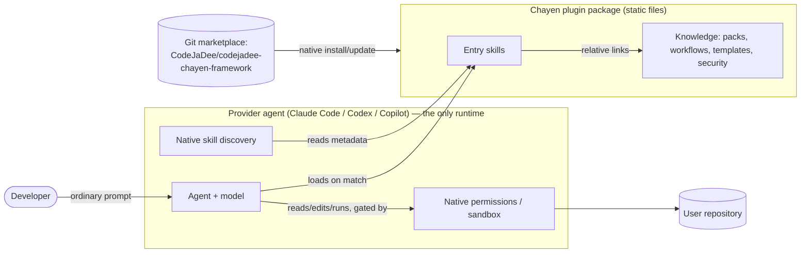
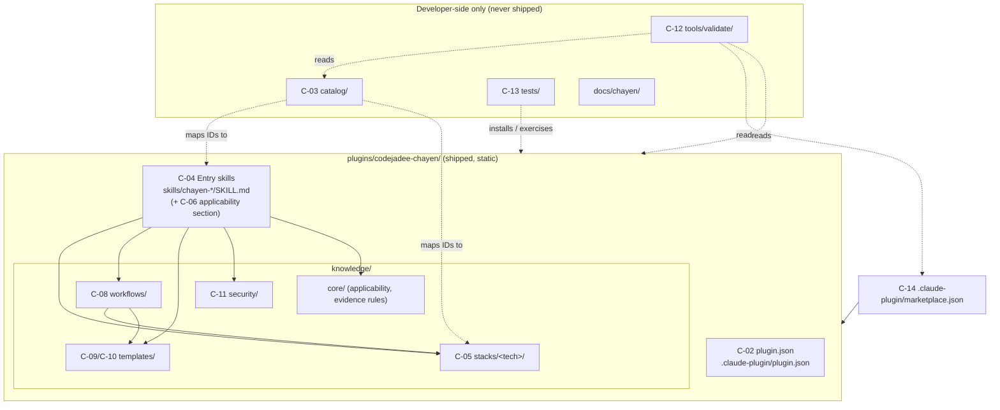
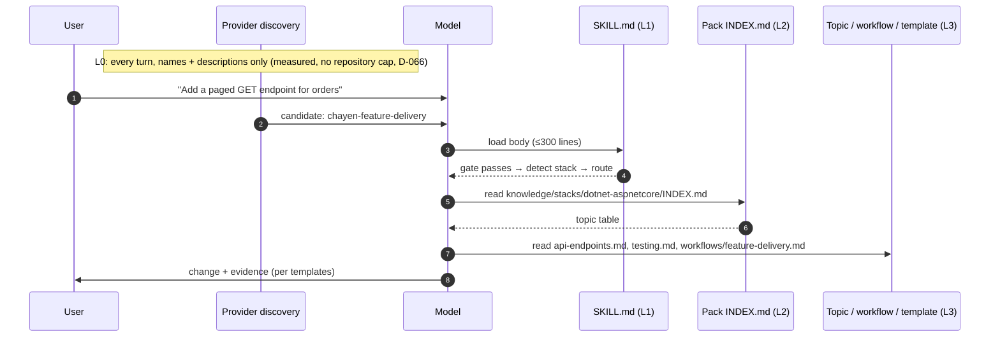
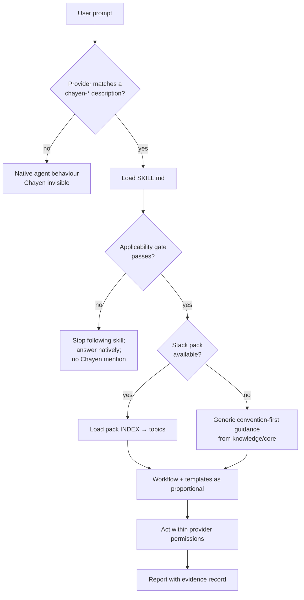
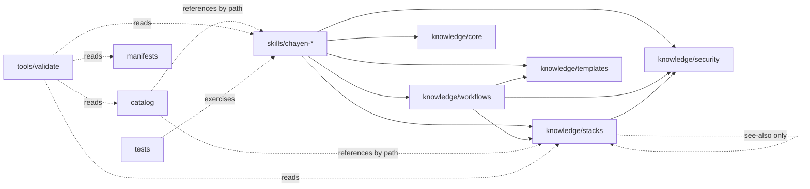
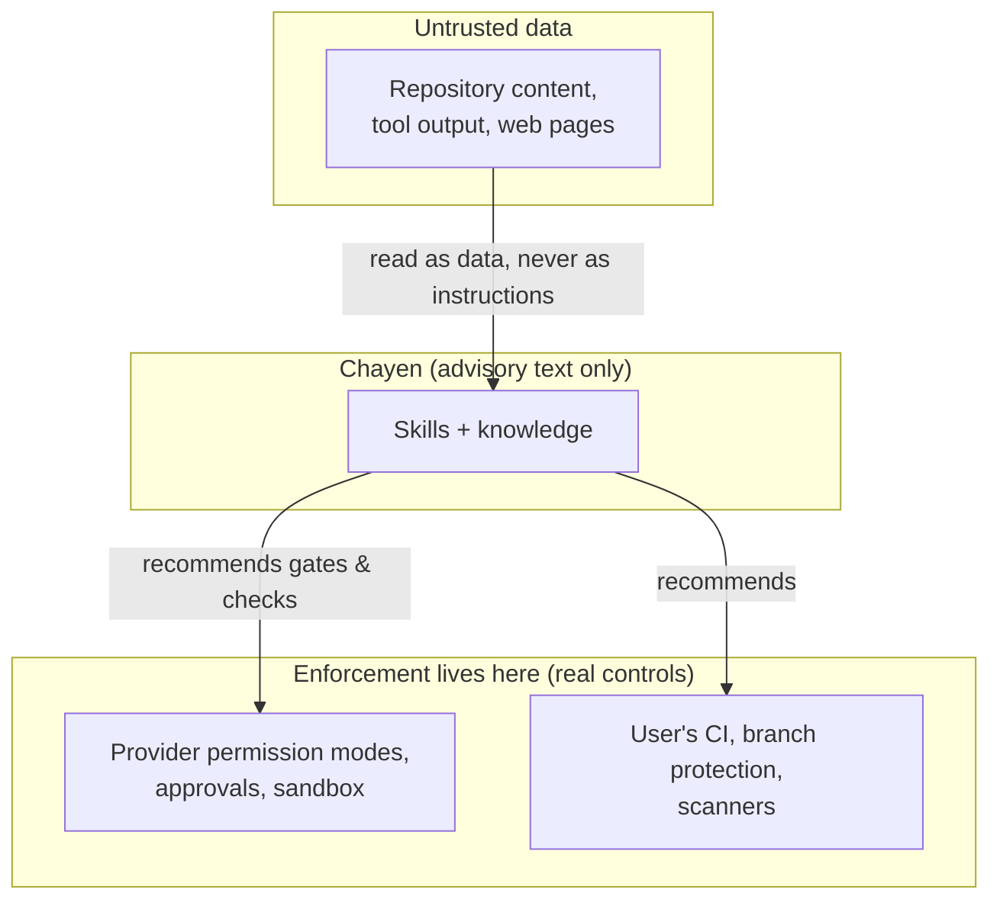

# Architecture — codejadee-chayen-framework

| Field | Value |
|---|---|
| Version | 0.1 (Step 03) |
| Date | 2026-10-14 |
| Status | **PROPOSED**: awaiting user review |
| Builds on | [PROVIDER_SPEC_RESEARCH.md](PROVIDER_SPEC_RESEARCH.md) (sources S1–S24), [PLUGIN_FORMAT_DECISION.md](PLUGIN_FORMAT_DECISION.md) (D-009, PROPOSED) |
| Package detail | [PLUGIN_PACKAGE_DESIGN.md](PLUGIN_PACKAGE_DESIGN.md) |
| Decisions | [ADRS/](ADRS/README.md) (ADR-0001 … ADR-0011; 0009–0011 PROPOSED in Step 35) |

> **Working names (provisional until ISSUES Q-03 is answered):**
> - plugin `codejadee-chayen`
> - marketplace `codejadee`
> - entry-skill prefix `chayen-`
>
> All are replaceable without structural change.
>
> **Step 36 registration amendment (D-053):** separate editorial registration
> and CA-01/V-19 changes are accepted and implemented. Maximum is **15** under
> the latest step request, superseding D-051's 25. Engineering Catalog stays
> unchanged; two Humanizers are registered as planned with no directories.
> Actual L0 5,485; projected with planned metadata 5,940 / 6,500. Shipped
> bodies/references/safety/discovery contracts apply equally to both categories.
> See [SKILL_REGISTRATION.md](SKILL_REGISTRATION.md); earlier pending-registry
> statements below describe historical Step 35 proposals. No host integration.
>
> **D-066 (2026-10-22, [ADR-0013](ADRS/ADR-0013-extensible-skill-governance.md)):**
> no Entry Skill count cap and no registration name allow-lists (evolution
> Step 03), no line or link-depth cap (Step 04), and no total-L0 cap (Step 05).
> Each is measured and reported instead; documented provider listing figures
> give advisory warnings. Caps written below are historical.
>
> **D-062 (2026-10-19):** `chayen-init` adds a project knowledge category
> (`catalog/project-skills.json`); maximum **16** Skills and L0 **7,000**;
> actual L0 6,563. See
> [ADR-0012](ADRS/ADR-0012-project-knowledge-initialization.md).
>
> **Step 35 L0 follow-up (D-052, 2026-10-17):** owner-authorized L0 ceiling
> is now **6,500 characters**, implemented in V-07 and evaluation reporting.
> Current metadata is unchanged at 5,485, leaving 1,015 characters; count
> remains capped at 25 (D-051), with target 15. This supersedes earlier
> pending-L0 statements below. Editorial registry and host policy proposals
> still await separate acceptance; no new Skills or host integration are added.
>
> **Step 35 owner follow-up (D-051, 2026-10-17):** the maximum Entry Skill
> count is now **25**, explicitly ACCEPTED and implemented in both count
> validators. Actual count remains 13; product target remains 15. L0 remains
> ≤5,500 characters; its proposed increase and editorial registry/persistent
> policy architecture still await approval. This narrow follow-up supersedes
> the count-only pending-approval statements in the original Step 35 note.
>
> **Step 35 governance extension (D-047–D-050, 2026-10-17):**
> Product scope adds two editorial Entry Skills (target 15, current 13) and
> ordinary-response multilingual style guidance. The architecture proposals
> are [ADR-0009](ADRS/ADR-0009-multilingual-editorial-skills.md),
> [ADR-0010](ADRS/ADR-0010-persistent-multilingual-response-style-policy.md) and
> [ADR-0011](ADRS/ADR-0011-multilingual-quality-and-safety.md), all PROPOSED.
> [HUMANIZER_ARCHITECTURE_IMPACT.md](HUMANIZER_ARCHITECTURE_IMPACT.md) analyzes
> native discovery, no-match/zero always-on conflicts, count/L0 limits,
> engineering registry ownership, zero runtime, portability and advisory
> boundaries. Native Plugin + Opt-in Host Persistent Instructions is preferred;
> strict install-only guaranteed always-on is UNVERIFIED, not claimed supported.
> Existing constraints below remain the baseline pending explicit acceptance
> of their proposed amendments. No Skills, integration, validators, manifests
> or user configuration are changed in Step 35. All MHR requirements remain
> PLANNED in [HUMANIZER_REQUIREMENTS.md](HUMANIZER_REQUIREMENTS.md).
>
> **Step 29 amendments (D-045):**
> - C-08 is implemented as 12 composite `kind: checklist` references in
>   existing entry skills, retaining the D-016 skill-local layout.
> - C-09/C-10 are implemented as seven reusable `kind: template` leaf
>   references in implementation, architecture and AI-engineering.
> - [WORKFLOW_COVERAGE.md](WORKFLOW_COVERAGE.md) maps all workflows to
>   existing recipes and conditional technology packs. V-24 checks static
>   coverage; native-agent behavior remains NOT_RUN. No runtime is added.
>
> **Step 08 amendments:**
> - The `SKILL.md` anatomy in C-04 is superseded by
>   [SKILL_AUTHORING_STANDARD.md](SKILL_AUTHORING_STANDARD.md) §4 (D-025):
>   a scope line, ten ordered sections including "Preconditions and inputs"
>   and "Safety boundaries", and a `Reference | Load when` table.
> - References declare a `kind`. Capability recipes are reference files,
>   never `SKILL.md` (D-026).
> - C-12 now covers V-17..V-22, the self-test runner, and `validate-all.mjs`.
>   The gates are in [SKILL_QUALITY_GATES.md](SKILL_QUALITY_GATES.md).
>
> **Step 07 amendments:**
> - C-03 is implemented as one YAML file,
>   `catalog/engineering-capabilities.yaml` (user-specified, D-021). It
>   replaces the JSON layout below.
> - IDs are `CAP-<domain 01..20>-<nnn>` (D-022). The record fields follow
>   the user's Step 07 list, as described in
>   [CAPABILITY_COVERAGE.md](CAPABILITY_COVERAGE.md) §3.
> - V-11 lives in `tools/catalog/check-catalog.mjs`.
> - The proposed 14-skill entry set (D-023, PROPOSED) supersedes the C-04
>   provisional list for mapping purposes. The final set is still Q-10.
>
> **Step 05 amendments:**
> - The pilot entry skills are the six user-specified skills (D-015), not
>   the provisional C-04 list.
> - References are skill-local (`skills/<skill>/references/`). The shared
>   `knowledge/` tree is deferred (D-016).
> - The description target is ≤420 characters (D-017).
>
> **Step 04 amendments:**
> - The plugin is implemented as `codejadee-chayen-framework` (D-014).
>   **Amended by D-059 (2026-10-17):** the plugin identifier is now `chayen`; the repository name and the directory `plugins/codejadee-chayen-framework/` are unchanged.
> - Each provider has its own native marketplace file (D-013). In C-02, the
>   `.agents/plugins/marketplace.json` row is no longer conditional, and
>   `.github/plugin/marketplace.json` has been added for Copilot.

---

## 1. Architectural drivers

### 1.1 Mandatory architecture constraints (user-specified, Step 03)

| ID | Constraint | Realised by |
|---|---|---|
| MA-01 | Native plugin-first | ADR-0001, C-01, C-14 |
| MA-02 | Skills-first | ADR-0002, C-04 |
| MA-03 | File-based knowledge and instructions | C-04..C-11 (Markdown and JSON only) |
| MA-04 | Provider-agnostic engineering capabilities | ADR-0006, C-03..C-11 |
| MA-05 | Provider-specific metadata only where necessary | ADR-0006, C-02 |
| MA-06 | Native agent skill discovery | ADR-0002, C-06 |
| MA-07 | No Chayen runtime, CLI, daemon, or custom installer | ADR-0005 |
| MA-08 | No unnecessary MCP services or hooks | ADR-0005, ADR-0007 |

### 1.2 Requirement drivers

These come from [PROJECT_CHARTER.md](PROJECT_CHARTER.md):

- REQ-01..REQ-10 (core requirements)
- EX-01..EX-07 (hard exclusions)

The traceability to components is in §9.

### 1.3 Key provider facts the design depends on

| Fact | Status | Source |
|---|---|---|
| All target providers discover `skills/<name>/SKILL.md` and choose skills by `name` + `description` | SUPPORTED | S3, S10, S15, S17, S19 |
| Progressive disclosure: metadata, then body, then referenced files | SUPPORTED | S7, S12, S19, S24 |
| The skill-listing budget is small (Claude Code 1% of the context window; Codex 2% or 8,000 characters) | SUPPORTED | S7, S12 |
| Copilot silently drops a plugin skill that collides with a project or personal skill name | SUPPORTED | S15 |
| Skill bodies can link to files **outside** their own skill directory, and every provider resolves them | **UNVERIFIED (U-11, new)** | — |

---

## 2. System context



Chayen contributes **only static files**. The provider supplies all
execution: discovery, file access, command execution, and permission prompts.
Chayen has no process, port, background task, or network endpoint.

---

## 3. Component model

| ID | Component | Location | Shipped to users | Provider-specific |
|---|---|---|---|---|
| C-01 | Portable Plugin Package | `plugins/codejadee-chayen/` | Yes (it *is* the shipment) | No |
| C-02 | Provider Compatibility Metadata | `plugin.json`, `.claude-plugin/plugin.json`, `.claude-plugin/marketplace.json` | Manifests: yes. Marketplace: catalog only. | **Yes, and only here** |
| C-03 | Engineering Capability Catalog | `catalog/` | No (developer-side source of truth) | No |
| C-04 | Entry Skills | `plugins/…/skills/chayen-*/SKILL.md` | Yes | No |
| C-05 | Technology Reference Packs | `plugins/…/knowledge/stacks/<tech>/` | Yes | No |
| C-06 | Skill Applicability Rules | Section of every `SKILL.md`, plus `knowledge/core/applicability.md` | Yes | No |
| C-07 | Progressive Reference Loading | Link structure and size budgets (enforced by C-12) | Yes (as structure) | No |
| C-08 | Composite Development Workflows | `plugins/…/knowledge/workflows/` | Yes | No |
| C-09 | Task Contract Templates | `plugins/…/knowledge/templates/task-contract.md` | Yes | No |
| C-10 | Evidence and Change Passport Templates | `plugins/…/knowledge/templates/` | Yes | No |
| C-11 | Security and Trust Guidance | `plugins/…/knowledge/security/` plus `SECURITY.md` (repo) | Guidance: yes | No |
| C-12 | Developer-only Validators | `tools/validate/` | **No** | No (they check provider metadata) |
| C-13 | Evaluation and Compatibility Test Suites | `tests/` | **No** | Adapters only |
| C-14 | Marketplace Distribution | Repo root as a Git marketplace, plus release tags | Catalog file | Marketplace file format only |



---

## 4. Component specifications

### C-01 Portable Plugin Package

- **The only distributable unit.** It is one directory, `plugins/codejadee-chayen/`,
  that every provider installs as is (ADR-0006, ADR-0008).
- **Content types:** Markdown files and two JSON manifests. Nothing else:
  no scripts, binaries, `package.json`, hooks, agents, commands, MCP, or LSP
  (ADR-0005).
- **Self-contained.** No file inside it links outside the plugin root, because
  provider caches copy only the plugin directory (S6, S15).
- The structure is in [PLUGIN_PACKAGE_DESIGN.md §2](PLUGIN_PACKAGE_DESIGN.md#2-plugin-package-c-01).

### C-02 Provider Compatibility Metadata

This is the **only** place where provider-specific files exist.

| File | Consumer | Rule set |
|---|---|---|
| `plugins/codejadee-chayen/plugin.json` | Codex, Copilot CLI, VS Code Copilot (Agent Plugins 1.0) | M-01, M-03..M-07 |
| `plugins/codejadee-chayen/.claude-plugin/plugin.json` | Claude Code. Also a fallback for Codex and Copilot. | M-02..M-07 |
| `.claude-plugin/marketplace.json` (repo root) | Claude Code, Copilot CLI, and Codex (legacy-compatible) | K-01, K-02, K-04 |
| `.agents/plugins/marketplace.json` | Codex | **Conditional** (K-03, U-02) |

Rules:

- Skills and knowledge files contain **no** provider-specific frontmatter
  (F-01).
- They contain no provider-only variables such as `${CLAUDE_PLUGIN_ROOT}`.
- They don't name provider-only tools (for example "use the Bash tool"). They
  use neutral verbs instead: "run", "read", "search", "edit" (rule P-01,
  ADR-0006).

### C-03 Engineering Capability Catalog

- **Purpose:** the developer-side source of truth that makes REQ-05 (206
  capabilities in 20 domains) traceable and testable. It is **not** shipped.
  The model never needs it, because routing lives in the entry skills
  (ADR-0004).
- **Format:** JSON (parseable without third-party libraries, BC-22).

  ```text
  catalog/
  ├── schema/catalog.schema.json      ← JSON Schema for the files below
  ├── domains.json                    ← 20 domain records
  └── capabilities/<domain-id>.json   ← capability records per domain
  ```

- **Capability record fields** (the schema is finalised in Step 04):

  | Field | Meaning |
  |---|---|
  | `id` | `CAP-<DOMAIN>-<NNN>`, unique |
  | `domain` | Domain ID (one of 20) |
  | `title`, `intent` | One line each |
  | `stacks[]` | Technology pack IDs it applies to, or `any` |
  | `entry_skill` | Exactly one `chayen-*` skill that routes to it |
  | `knowledge[]` | Plugin-relative paths of the topic files that implement it |
  | `workflow` | Optional workflow ID |
  | `verification` | `{ "method": "...", "eval_cases": [...] }` |
  | `status` | `PLANNED` / `IMPLEMENTED` / `VERIFIED` (mirrors the acceptance matrix) |

- **Invariants** (checked by C-12):
  - exactly 20 domains and 206 capabilities, or as amended by a recorded
    decision;
  - every `entry_skill` and `knowledge` path exists;
  - no capability is `IMPLEMENTED` while it points at placeholder content
    (BC-14).

### C-04 Entry Skills

Entry skills are the **only** objects the provider's discovery sees.

- **Shape:** task-intent skills, not one skill per capability and not one per
  technology (ADR-0004).
- **Budget** (enforced by C-12, derivation in §8):
  - no cap on registered or shipped entry skills (D-066; previously 16 D-062, 15 D-053, 25 D-051);
  - each `description` targets ≤280 characters (hard limit 1024);
  - Chayen's total listing metadata is measured and reported, with no repository cap (D-066); provider listing limits still apply (formerly ≤7,000 D-062, 6,500 D-052, 5,500 D-037).
- **Naming:** `chayen-<intent>`. The prefix is short, which gives collision
  resistance against Copilot's silent drop (F-05, R-10).
- **`SKILL.md` anatomy** (template in PLUGIN_PACKAGE_DESIGN §4):
  1. Frontmatter: `name` and `description` only (plus optional `license` and
     `metadata`).
  2. **Applicability gate** (C-06).
  3. Precedence statement (§4 C-06).
  4. Procedure: detect stack and conventions → pick workflow → load knowledge
     → act → verify.
  5. Routing table: detected technology to pack `INDEX.md`, and task shape to
     workflow.
  6. Evidence and output requirements (C-10).
- **Provisional entry-skill set.** The final set is fixed in Step 04 against
  the approved catalog.

  | Skill | Covers (intent) |
  |---|---|
  | `chayen-feature-delivery` | Implement features, endpoints, pages, and full-stack slices |
  | `chayen-bug-fix` | Reproduce, find the root cause, fix, add a regression test |
  | `chayen-code-review` | Review diffs or PRs for correctness, maintainability, and conventions |
  | `chayen-refactor` | Behaviour-preserving structural change |
  | `chayen-api-design` | HTTP/REST contracts, versioning, validation, error models |
  | `chayen-database` | Schema, queries, migrations, indexing (SQL Server, PostgreSQL) |
  | `chayen-frontend` | Components, state, forms, routing, accessibility |
  | `chayen-testing` | Test strategy and authoring (unit, integration, e2e) |
  | `chayen-security` | Secure coding review and hardening (advisory) |
  | `chayen-performance` | Profiling-driven performance work |
  | `chayen-architecture` | Solution structure, boundaries, design trade-offs |
  | `chayen-build-deploy` | Build, CI/CD, containers, configuration |
  | `chayen-upgrade-migration` | Framework and dependency upgrades, platform migrations |
  | `chayen-docs-handover` | Technical docs, ADRs, handover and onboarding notes |

### C-05 Technology Reference Packs

> **As built (Step 20, D-039):** skills cannot link outside their own
> directory (D-016), so a pack is not a shared `knowledge/stacks/` folder.
> Its `kind: technology` references live in the skills that use them, and
> the pack is tracked in `catalog/technology-capabilities.yaml`. See
> [TECHNOLOGY_COVERAGE.md](TECHNOLOGY_COVERAGE.md) §2.

- **One pack per technology**, shared by every entry skill. There is one
  canonical copy, with no per-skill duplication.

  ```text
  knowledge/stacks/<tech>/
  ├── INDEX.md          ← detection signals, version notes, topic list (≤80 lines)
  └── <topic>.md        ← one focused topic per file (≤300 lines)
  ```

- **Pack IDs** map to the charter's stack list:

  | Tier | Pack IDs |
  |---|---|
  | Primary | `dotnet-aspnetcore`, `angular`, `sqlserver` |
  | Additional | `typescript-javascript`, `react`, `nextjs`, `vue`, `nuxt`, `vite`, `python`, `postgresql` |
  | Optional | `java` (pending Q-08) |

- **Pack `INDEX.md` contents:**
  - **Detection signals:** files and markers that identify the technology and
    its version, such as `*.csproj` / `TargetFramework`, `angular.json`, and
    `package.json` dependencies.
  - **Supported version range** and version-specific caveats.
  - **"Detect existing convention first" checklist.**
  - **Topic table:** topic file, what it covers, and when to load it.
- **Topic file sections:**
  - Applies to (versions)
  - Repository conventions to check first
  - Guidance
  - Verification commands (build, test, lint)
  - Pitfalls
  - See also (at most 3 sibling links)

### C-06 Skill Applicability Rules

Applicability is applied in **three layers**:

| Layer | Mechanism | Enforced by |
|---|---|---|
| L-A: Discovery | The `description` states positive triggers **and** scope boundaries ("not for …") | The provider's native matching. Measured by C-13. |
| L-B: In-skill gate | The first section of every `SKILL.md` lists *Applies when* and *Does not apply when*. If the gate fails, the agent stops following the skill and answers natively, without mentioning Chayen (ADR-0003). | Model compliance (advisory). Measured by C-13. |
| L-C: Partial match | Use only the applicable parts. A stack without a pack gets generic, convention-first guidance and is never forced into a known stack's patterns. | Model compliance. Measured by C-13. |

**Precedence order** (stated in every entry skill and in
`knowledge/core/applicability.md`):

1. The user's explicit instructions in the conversation.
2. Repository instruction files (`AGENTS.md`, `CLAUDE.md`,
   `.github/copilot-instructions.md`, and similar).
3. Established conventions observed in the repository (structure, naming,
   libraries, test style).
4. Chayen guidance.
5. The model's general knowledge.

### C-07 Progressive Reference Loading



> The INDEX layer, line budgets and two-hop rule in this subsection are the
> original Step 03 design. The L0 row is current; for the rest, see "As
> built (D-066)" after the rules below.

| Level | Content | Loaded when | Budget |
|---|---|---|---|
| L0 | `name` + `description` of each entry skill | Always (by the provider) | Measured and reported, no repository cap (D-066); provider listing limits apply |
| L1 | `SKILL.md` body | On match | ≤300 lines (spec allows 500) |
| L2 | Pack `INDEX.md`, workflow file, template | When the skill routes to it | ≤80 lines per INDEX. ≤200 lines per workflow or template. |
| L3 | Topic files | When INDEX or a workflow points to them | ≤300 lines each |

**Rules:**

- At most **two hops** from `SKILL.md` (SKILL → INDEX/workflow → topic).
  - This deliberately goes one hop past the Agent Skills recommendation of
    "one level deep" (S24), so that 206 capabilities can be indexed without
    bloating L1.
  - The deviation is recorded in ADR-0004 and measured in C-13.
- No reference cycles.
- Links are plain relative Markdown links.

> **As built (D-066, evolution Step 04):** there is no INDEX layer, no line
> budget and no hop limit. References are skill-local (D-016). Each one is
> reachable from `SKILL.md`, either listed in its References table or reached
> through another reference with a stated load condition; orphans fail. V-06
> reports sizes and estimated tokens, with an advisory warning above the
> provider recommendation for `SKILL.md` (under 500 lines, ~5,000 tokens). V-08
> walks the link graph without recursion and reports cycles. A reachable file
> is not necessarily a read file: providers load references only when the
> instructions point to them.

### C-08 Composite Development Workflows

- Multi-phase procedures that an entry skill hands the model. **The model
  follows them; nothing executes them.**
- **Provisional set:**
  - `feature-delivery` (full-stack: DB → API → UI → tests)
  - `bug-fix`
  - `safe-refactor`
  - `db-schema-change`
  - `dependency-upgrade`
  - `security-review`
  - `performance-investigation`
  - `code-review`
  - `release-readiness`
- **Workflow file anatomy:**
  - purpose, and entry criteria;
  - phases, each with: inputs, steps, the relevant pack topics (resolved
    through the pack INDEX), and an exit check;
  - **approval gates** for risky actions (schema changes, deletions, auth
    changes, production configuration);
  - required evidence (C-10);
  - proportionality rule: phases may be skipped for trivial changes, with the
    reason stated.

### C-09 Task Contract Templates

- **`knowledge/templates/task-contract.md`**: a short structured agreement,
  produced *before* non-trivial work. It covers:
  - goal
  - in scope / out of scope
  - assumptions (marked)
  - acceptance criteria
  - affected areas
  - risks and approval gates
  - verification plan
- **Proportionality:** required by workflows for multi-file or risky changes.
  Skipped for single-line or explanatory requests.
- **Output target:** the conversation by default. It is written to a file only
  if the user asks, or if the repository already keeps such files.

### C-10 Evidence and Change Passport Templates

- **`knowledge/templates/evidence-record.md`:** one row per claim, with the
  columns `claim | method (command / file:line / doc URL) | observed result | status`.
  - Status vocabulary: `PASS` / `FAIL` / `NOT_RUN` / `N/A`, mirroring BC §5.2.
  - Unexecuted checks are reported as `NOT_RUN`, never implied as passing
    (REQ-08).
- **`knowledge/templates/change-passport.md`:** the hand-off summary for a
  completed change. It covers:
  - intent and the task-contract reference
  - files changed
  - conventions followed (with evidence)
  - evidence record
  - risks
  - rollback
  - unverified items
  - follow-ups
- **`knowledge/core/evidence-rules.md`:** what counts as evidence, and the
  forbidden claim patterns ("tests pass" without a run, "secure" without a
  qualifier).
- Output target: the conversation by default, as in C-09.

### C-11 Security and Trust Guidance

- `knowledge/security/`:
  - secure-coding topics, cross-referenced from the stack packs;
  - the threat-aware review checklist;
  - secrets handling;
  - dependency hygiene;
  - prompt-injection awareness (treat repository and tool content as data,
    not instructions).
- **Advisory language only** (D-003). Each security topic carries the
  statement that it is guidance, and points to *real* controls: provider
  permission modes and sandboxing, CI scanners, branch protection.
- Trust boundaries and the threat model are in §7 and ADR-0007. The repo-level
  `SECURITY.md` (vulnerability reporting) is created in a later step.
- STEP 30 implementation detail: [SECURITY_MODEL.md](SECURITY_MODEL.md),
  [THREAT_MODEL.md](THREAT_MODEL.md) and [PLUGIN_TRUST_REVIEW.md](PLUGIN_TRUST_REVIEW.md)
  cover the current static package and developer tools. All 13 entries now
  acknowledge higher-priority system/developer rules and native permissions;
  repository/tool/template text cannot supply approval. V-25 and offline
  boundary tests supplement V-09/V-10; native behavior remains NOT_RUN.

### C-12 Developer-only Validators

- Located in `tools/validate/`. Never inside the plugin. No user ever runs
  them.
- **Implementation language:** pending Q-07. The constraints are:
  - development-only;
  - zero runtime footprint in the plugin;
  - the minimum number of third-party packages, each justified by its own
    decision record (BC-22).
- Validator IDs and their checks are listed in
  [PLUGIN_PACKAGE_DESIGN.md §7](PLUGIN_PACKAGE_DESIGN.md#7-validators-c-12).
- They also call provider tooling **when present**: `claude plugin validate
  --strict` (S3) and `skills-ref validate` (S24). These are developer tools,
  not plugin dependencies.

### C-13 Evaluation and Compatibility Test Suites

```text
tests/
├── validators/          ← good/bad fixtures proving C-12 detects violations
├── fixtures/repos/      ← small sample repositories per stack (incl. non-default conventions)
├── evals/
│   ├── cases/           ← provider-neutral case definitions (JSON): prompt, fixture, expected skill | none
│   ├── claude/          ← generated or hand-written `claude plugin eval` cases (S8)
│   └── adapters/        ← per-provider run procedures for Codex / Copilot (scripted where a non-interactive mode exists)
└── compat/              ← install/update/disable/uninstall smoke procedures + recorded transcripts
```

| Suite | Proves | Provider coverage |
|---|---|---|
| Structural | C-12 rules hold | Provider-independent |
| Install / lifecycle smoke | REQ-01 on each surface | One procedure per surface. Results recorded with commands and output. |
| Positive trigger | REQ-02, REQ-03: ordinary prompts with no "Chayen" in them select the expected entry skill | Claude: `claude plugin eval` with a `tool_used: Skill` grader (S8). Others: adapters. |
| Negative trigger | REQ-04: unrelated prompts select **no** Chayen skill | Claude: `min: 0`, `max: 0` with `arm: both` (S8). Others: adapters. |
| Behavioural | REQ-07, REQ-08: conventions preserved, evidence reported | Fixture repos plus graders |
| Regression | All of the above re-run on each release and on provider model changes | All |

Eval cases may live outside the plugin root and point at it with
`plugins: [...]` (S8). Whether a full suite directory outside the plugin is
accepted is **UNVERIFIED (U-12)**.

### C-14 Marketplace Distribution

- **The repository root is the Git marketplace.** It holds
  `.claude-plugin/marketplace.json`, with one entry whose `source` is
  `"./plugins/codejadee-chayen"`.
- **Install path** for users: add the marketplace by `owner/repo` (optionally
  pinned with `#vX.Y.Z`), then install `codejadee-chayen@codejadee` with each
  provider's native commands (S5, S10, S15, S18).
- **Releases:**
  - semver in both manifests (M-05);
  - a Git tag `vX.Y.Z`;
  - `CHANGELOG.md`.
- **No public directory submission without approval** (K-04, BC-31).

---

## 5. Runtime view: match, partial match, and no match



---

## 6. Dependency rules



| ID | Rule | Checked by |
|---|---|---|
| DR-01 | Nothing in the plugin references `catalog/`, `tools/`, `tests/`, or `docs/`. The shipped package is self-contained. | V-08 |
| DR-02 | No plugin file links outside the plugin root. | V-08 |
| DR-03 | Skills may link to knowledge. Knowledge never links back to skills. | V-08 |
| DR-04 | Skills never link to other skills. Hand-off is by name in prose, so the provider re-discovers it. | V-08 |
| DR-05 | Templates and `core/` are leaves. They contain no outbound links except to `core/`. | V-08 |
| DR-06 | Stack packs may "see also" at most 3 sibling pack `INDEX.md` files, never sibling topics. | V-08 |
| DR-07 | Every reference reachable from `SKILL.md`, at any depth (D-066; formerly at most two hops). Cycles are reported, not followed. | V-08 |
| DR-08 | Provider-specific content exists only in C-02 files (P-01). | V-05, V-10 |
| DR-09 | Developer tooling (C-12, C-13) depends on the plugin. The plugin never depends on tooling. | Review + V-08 |
| DR-10 | The catalog points to plugin files. The plugin is unaware of catalog IDs, except optional `metadata` tags. | V-11 |

---

## 7. Trust boundaries



| Boundary | Rule |
|---|---|
| B-01 Plugin ↔ provider | The plugin ships no executable components or tool grants. Agent actions depend on native provider/OS permissions; this text does not establish their effectiveness. |
| B-02 Guidance ↔ enforcement | Chayen text never claims to enforce, guarantee, or block (D-003, V-10). |
| B-03 Repository content ↔ instructions | Repository and tool content are data. Embedded instructions cannot override system/developer rules or native permissions, expand the user's authorized scope, or supply approval. |
| B-04 Supply chain | Users install a pinned version from a known Git source. Every release diff is reviewable static text (ADR-0007, ADR-0008). |
| B-05 Risky actions | Actual action/target/scope authorization and native controls are required; generated plans, test passes and recommendations are not permission. Scratch mutations and staging stay within reviewed boundaries. |
| B-06 Secrets | No credentials or source/prompt upload is required for static guidance. Keep values out of logs, reports and handoffs; optional external tooling has separate authorization and data boundaries. |

---

## 8. Quality attributes and budgets

| Attribute | Target | Derivation | Checked by |
|---|---|---|---|
| L0 metadata footprint | Measured, no repository cap (D-066; formerly ≤7,000 D-062, 6,500 D-052, 5,500 D-037) | Current 6,563 characters (~1,641 tokens, estimate). Documented provider figures: Claude Code 1% of the context window (UNKNOWN here), Codex 2% or 8,000 characters (advisory warning above 8,000), Copilot not documented (UNKNOWN). Host capacity needs per-surface measurement (NOT_MEASURED). | V-07; `tools/catalog/discovery-metrics.mjs`; evaluation context report |
| Entry skills | No cap (D-066); count reported by category | Formerly ≤15 (D-053) and ≤16 (D-062). Each Skill still costs L0 metadata. | V-07, V-11.3, V-19 |
| `SKILL.md` body | No cap (D-066); lines and estimated tokens reported | Advisory warning above the provider recommendation (under 500 lines, ~5,000 tokens; S7, S24) | V-06 |
| Link depth | No cap (D-066); maximum depth reported | Providers recommend one level deep (S24); deeper references are allowed and reported | V-08 |
| Trigger precision and recall | Measured, not assumed. Targets are set after the first eval baseline. | R-02 | C-13 |
| Runtime footprint | Zero processes, zero network, zero executables | MA-07 | V-09 |

---

## 9. Requirement traceability (design level)

| Req | Components | ADR |
|---|---|---|
| REQ-01 | C-01, C-02, C-14 | 0001, 0008 |
| REQ-02 | C-04, C-06 (L-A), C-13 | 0002 |
| REQ-03 | C-04 descriptions (no "Chayen" trigger needed), C-13 | 0002 |
| REQ-04 | C-06 (L-B), no always-on components, C-13 negative suite | 0003 |
| REQ-05 | C-03, C-04, C-05 | 0004 |
| REQ-06 | C-07, C-05 | 0004 |
| REQ-07 | C-06 precedence, C-05 "detect first" | 0003 |
| REQ-08 | C-08, C-09, C-10 | — |
| REQ-09 | C-11, B-01..B-04, V-10 | 0007 |
| REQ-10 | C-12, C-13 | 0006 |
| EX-01..EX-07 | C-01 content rules, V-09 | 0005 |

---

## 10. Assumptions and unverified provider behaviour

| ID | Item | Status | Impact if false | Resolution |
|---|---|---|---|---|
| U-01 | Claude Code tolerates a root `plugin.json` | UNVERIFIED | Drop the root manifest (D-009 Option B) | Steps 05/06 |
| U-02 | Codex reads the Claude-format marketplace file as is | UNVERIFIED | Add `.agents/plugins/marketplace.json` (K-03) | Step 07 |
| U-05 | Copilot and VS Code auto-invoke plugin-bundled skills | UNVERIFIED | REQ-02 is partially unmet on those surfaces | Steps 08/10 |
| U-06 | Copilot and VS Code skill-listing budgets | UNVERIFIED | AS-03 budget may need tightening | Step 10 |
| U-10 | Non-standard frontmatter handling | UNVERIFIED | Avoided by design (F-01) | Step 05 |
| **U-11** (new) | Every provider resolves relative links from `SKILL.md` to files outside the skill directory (`../../knowledge/...`) and lets the model read them | **UNVERIFIED** | Shared knowledge unreachable. **Fallback:** the developer-side vendoring step (PLUGIN_PACKAGE_DESIGN §6.2) | Steps 06–08 |
| **U-12** (new) | `claude plugin eval` runs a case directory kept outside the plugin root via `plugins:` paths | **UNVERIFIED** | Eval cases must sit inside the plugin (shipped, but inert) | Step 05/10 |
| **U-13** (new) | Codex, Copilot, and VS Code ignore unknown top-level plugin directories (`knowledge/`) rather than rejecting the plugin | **UNVERIFIED** (the spec says clients ignore unsupported component types, S20) | Rename or relocate `knowledge/` under `skills/` | Steps 06–08 |
| AS-01 | Task-intent entry skills trigger reliably across stacks | Assumption | Switch to stack-scoped entry skills (ADR-0004 revisit trigger) | Step 10 |
| AS-02 | Models follow the in-skill applicability gate | Assumption | Higher false-positive cost. Tighten descriptions. | Step 10 |
| AS-03 | ≈4 characters per token when converting Claude's 1% budget | Assumption | Budget recalculation | Step 10 |
| AS-04 | Two-hop references are followed in practice | Assumption | Flatten: SKILL links topics directly for the primary stacks | Step 10 |

The other items (U-03, U-04, U-07, U-08, U-09) affect packaging and test
procedure, not this architecture's structure. They are tracked in
[PROVIDER_SPEC_RESEARCH.md §8](PROVIDER_SPEC_RESEARCH.md).
