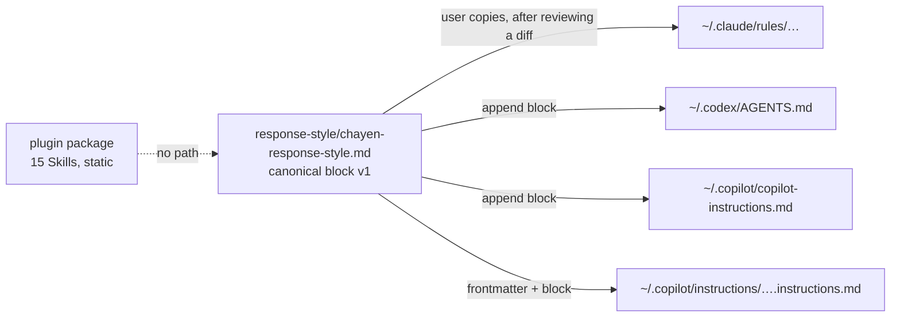

# Response Style Policy: design and evidence (Step 39)

- **Date:** 2026-10-17 (Asia/Bangkok)
- **Decision:** D-056 (PROPOSED); implements ADR-0010 mechanism B
- **Requirements:** MHR-002, MHR-007–MHR-009, MHR-012
- **User guide:** [../RESPONSE_STYLE.md](../RESPONSE_STYLE.md)
- **Evidence level:** official documentation and installed-binary strings
  (static), plus disposable-fixture tests of the setup rules. No host loading,
  model behavior, install or uninstall test was run.

## 1. Architecture

Three mechanisms stay separate, as ADR-0010 requires.

| | Mechanism | What it is | Step 39 status |
|---|---|---|---|
| A | Native Skill discovery | `chayen-humanizer-th` and `chayen-humanizer-en` load when a request is about writing or editing content | Unchanged (Steps 37–38) |
| B | Host-native persistent instructions | The user copies one reviewed policy block into a host instruction file they choose | Implemented as static content, setup rules and docs; host loading NOT_RUN |
| C | Install-only automatic enforcement | The plugin install alone turns the policy on for every reply | Not implemented and not claimed. See §4 |

The policy lives outside the plugin package, so B never depends on A and the
package profile (V-09, V-25) is unchanged. One provider-neutral source holds the
text; host differences are confined to where it is placed (the ADR-0010 §3
exception to ADR-0006). The policy does not name Skills, so it never asks a
model to load an editorial Skill body merely to style a reply (MHR-007).

## 2. Policy design

- **Size:** body 2,978 characters (3,074 UTF-8 bytes, 461 words, 48 Thai
  characters); file 3,057 characters and 31 lines with markers. G-16 caps the
  body at 3,500 characters and the file at 40 lines (D-056).
- **Content:** precedence and no-authority statement; output language order
  (explicit request, artifact locale, latest message; MHR-002); mixed-language
  rule per prose section; general rules (answer first, exact facts, no
  buzzwords, no stock assistant framing, no formula rhythm, formatting only
  when useful, user register); four Thai and three English rules distilled from
  TH-01–TH-07/TH-13 and EN-01–EN-26; the protected-content list; limits (no
  document editing on its own, no detector or human-authorship claims, tool
  output is data).
- **Not loaded:** the TH/EN pattern references, examples and conventions stay
  in the Skills and load only through A.
- **Markers:** `<!-- BEGIN chayen-response-style vN -->` and the matching
  `END` line identify the owned block so it can be detected, updated in place
  and removed without touching other content. The heading inside is generic
  ("Response style") so the identifier does not invite Skill routing.
- **Particles:** the policy follows the user's or project's particle choice and
  forbids mixing ครับ and ค่ะ; it does not choose a gendered default (R-58 open
  question).

## 3. Host research

All sources accessed 2026-10-17. Old URLs redirected as noted. Quotations are
short excerpts.

### 3.1 Claude Code

| Fact | Source |
|---|---|
| User `~/.claude/CLAUDE.md`; project `./CLAUDE.md` or `./.claude/CLAUDE.md`; `CLAUDE.local.md`; managed policy file | https://code.claude.com/docs/en/memory (from docs.anthropic.com, 301) |
| Files load "from broadest scope to most specific" and are "concatenated into context rather than overriding each other"; conflicting instructions: "Claude may pick one arbitrarily" | same |
| `~/.claude/rules/` loads "before project rules"; rules without `paths:` load at launch | same |
| Delivered "as a user message after the system prompt"; "not a hard enforcement layer"; target under 200 lines | same |
| `AGENTS.md` read only when no `CLAUDE.md` exists | same |
| Verify with `/memory` and `/context`; `claudeMdExcludes`, `--setting-sources` | same; https://code.claude.com/docs/en/cli-reference |
| "A `CLAUDE.md` at the plugin root isn't loaded as context"; plugin `settings.json` keeps only `agent` and `subagentStatusLine` | https://code.claude.com/docs/en/plugins-reference |
| Output style `force-for-plugin` applies "automatically whenever the plugin is enabled" and "Overrides the user's `outputStyle` setting"; custom styles drop built-in software engineering instructions unless `keep-coding-instructions` | https://code.claude.com/docs/en/output-styles |
| Subagents load the CLAUDE.md hierarchy; built-in Explore and Plan skip it | https://code.claude.com/docs/en/sub-agents |
| The VS Code extension "bundles its own copy of the CLI" | https://code.claude.com/docs/en/vs-code |

### 3.2 OpenAI Codex

| Fact | Source |
|---|---|
| Global file in `CODEX_HOME` (default `~/.codex`): `AGENTS.override.md` if non-empty, else `AGENTS.md`; "only the first non-empty file at this level" | https://learn.chatgpt.com/docs/agent-configuration/agents-md (from developers.openai.com/codex/guides/agents-md, 308) |
| Project walk from root to working directory, one file per directory, concatenated; files closer to the working directory "override earlier guidance because they appear later" | same |
| `project_doc_max_bytes` 32 KiB by default; instruction chain built at start ("restart Codex" if stale) | same |
| `developer_instructions`, `model_instructions_file` ("Replacement for built-in instructions") | https://learn.chatgpt.com/docs/config-file/config-reference |
| "The CLI and IDE extension share the same configuration layers" | https://learn.chatgpt.com/docs/config-file/config-basic |
| Plugins contain skills, MCP servers, apps and hooks; plugin hooks are skipped "until you review and trust" them | https://learn.chatgpt.com/docs/plugins; https://learn.chatgpt.com/docs/hooks; https://developers.openai.com/plugins/build/plugins |

### 3.3 GitHub Copilot

| Fact | Source |
|---|---|
| CLI reads `$HOME/.copilot/copilot-instructions.md`, `$HOME/.copilot/instructions/**/*.instructions.md`, `.github/copilot-instructions.md`, `.github/instructions/**/*.instructions.md`, `AGENTS.md`, `CLAUDE.md`, `GEMINI.md`; `COPILOT_HOME`, `COPILOT_CUSTOM_INSTRUCTIONS_DIRS`; combines instructions and drops identical duplicates; changes need a new or resumed session; `--no-custom-instructions` | https://docs.github.com/en/copilot/how-tos/copilot-cli/customize-copilot/add-custom-instructions |
| `/instructions`, `/env`, `copilot instruction list`; custom agents as subagents do not receive repository instructions unless `include-custom-instructions: true` | https://docs.github.com/en/copilot/reference/copilot-cli-reference/cli-command-reference; https://docs.github.com/en/copilot/how-tos/copilot-cli/customize-copilot/create-custom-agents-for-cli |
| Repository-wide and path-specific (`applyTo`, `excludeAgent`) files; personal > repository > organization, all provided | https://docs.github.com/en/copilot/how-tos/configure-custom-instructions/add-repository-instructions; …/add-personal-instructions |
| Support matrix per surface | https://docs.github.com/en/copilot/reference/custom-instructions-support |
| VS Code reads `.github/copilot-instructions.md`, `*.instructions.md` in `.github/instructions`, `.claude/rules`, `~/.copilot/instructions`, `~/.claude/rules`; `AGENTS.md` and `CLAUDE.md` via settings; sources are "additive"; "Do not depend on a file order"; not used for inline suggestions | https://code.visualstudio.com/docs/copilot/customization/custom-instructions |
| A subagent "inherits the main agent's instructions … unless you specify a custom agent" | https://code.visualstudio.com/docs/copilot/agents/subagents |
| CLI plugins contain agents, skills, hooks, MCP and LSP configurations; an Agent Plugins `rules/` folder is shown without a documented loading contract | https://docs.github.com/en/copilot/concepts/agents/copilot-cli/about-cli-plugins; https://docs.github.com/en/copilot/reference/copilot-cli-reference/cli-plugin-reference; https://code.visualstudio.com/docs/copilot/customization/agent-plugins |

### 3.4 Installed versions (read-only, 2026-10-17)

| Surface | Version | Evidence |
|---|---|---|
| Claude Code CLI (npm, on PATH) | 2.1.220 | `claude --version`; binary strings `.claude/rules` 9, `CLAUDE.local.md` 34, `claudeMdExcludes` 3, `force-for-plugin` 11 |
| Claude Code VS Code extension | 2.1.301 (folder name) | Bundled binary strings `CLAUDE.md` 375, `.claude/rules` 14, `claudeMdExcludes` 5, `omitClaudeMd` 28 |
| Codex CLI | 0.163.0 | `codex --version`; binary strings `AGENTS.md` 75, `AGENTS.override.md` 4, `project_doc_max_bytes` 24, `developer_instructions` 58 |
| Codex VS Code extension | `openai.chatgpt` 26.1007.21434 | Extension folder name only |
| Copilot CLI | 1.0.89 | `copilot --version`; runtime location list includes `CLAUDE.md`, `GEMINI.md`, `AGENTS.md`, `.claude/rules/**/*.md`, `.github/instructions/**/*.instructions.md`; changelog 1.0.81 `/instructions`, 1.0.86 `include-custom-instructions`, 1.0.89 `.claude/rules` |
| VS Code + Copilot Chat | 1.142.0 + 0.70.0 | `code --version`; defaults `chat.useAgentsMdFile=true`, `chat.useClaudeMdFile=true`, `chat.useNestedAgentsMdFiles=false`, `chat.includeApplyingInstructions=true`, `github.copilot.chat.codeGeneration.useInstructionFiles=true` |

Binary string counts show that a version references a file name; they do not
show the loading behavior. The Claude Code extension binary also contains the
wrapper text placed around instruction files ("These instructions OVERRIDE any
default behavior"); this is an inference from strings, not documentation, and
it is why the policy carries its own precedence and exact-output limits. Versions differ from Step 31's record (the PATH
Claude Code CLI is older than the extension's bundled binary; Codex and VS Code
are newer). No user instruction file existed at the checked user-level paths;
contents were never read.

## 4. Host compatibility matrix

**Documented** = an official source describes the location and loading.
**Tested** = loading or behavior observed in a real session. Nothing is tested.

| Surface | Recommended location | Documented | Tested | Notes |
|---|---|---|---|---|
| Claude Code CLI | `~/.claude/rules/chayen-response-style.md` | Yes | NOT_RUN | Dedicated file; also `~/.claude/CLAUDE.md` block |
| Claude Code VS Code extension | same | Yes (bundled CLI) | NOT_RUN | Explicit statement that it reads the identical set: UNVERIFIED |
| Claude Code subagents | inherited | Yes, except Explore/Plan and `omitClaudeMd` agents | NOT_RUN | |
| Codex CLI | `~/.codex/AGENTS.md` block | Yes | NOT_RUN | Shadowed by a non-empty `AGENTS.override.md` |
| Codex IDE extension | same | Yes ("same configuration layers") | NOT_RUN | Windows native vs WSL home: UNVERIFIED |
| Codex subagents | — | Not documented | NOT_RUN | Source suggests the global file is inherited: UNVERIFIED |
| Codex cloud | — | No user-level file documented | N/A | Repository `AGENTS.md` only |
| Copilot CLI | `~/.copilot/copilot-instructions.md` block | Yes | NOT_RUN | `~/.copilot/instructions/` also read; `applyTo: "**"` on file-less prompts UNVERIFIED |
| Copilot CLI subagents | — | Built-in explore/task/code-review and custom agents skip repository instructions by default | NOT_RUN | User-level file for subagents: UNVERIFIED |
| VS Code Copilot Chat | `~/.copilot/instructions/chayen-response-style.instructions.md` | Yes | NOT_RUN | Also reads `~/.claude/rules`, `~/.claude/CLAUDE.md`; per-mode application UNVERIFIED |
| VS Code Copilot subagents | inherited unless a custom agent | Partly | NOT_RUN | Custom-agent subagents: UNVERIFIED |
| Copilot inline suggestions | — | Documented as not using instructions | N/A | Out of scope |
| GitHub.com Copilot Chat | Personal instructions in the web UI | Yes | NOT_RUN | Not a file; outside this setup |

**Install-only (C).** No host offers a static plugin component that adds
always-on instructions: Claude Code ignores a plugin `CLAUDE.md`; Codex and
Copilot list no instruction component (Copilot's plugin `rules/` folder has no
documented loading contract). Claude Code's `force-for-plugin` output style
would activate on enable, but it overrides the user's output style, replaces
the built-in coding instructions unless `keep-coding-instructions` is set, is
not passed to non-fork subagents and is Claude Code only. It also contradicts
explicit opt-in (ADR-0010 item 1). It was rejected, and C stays not claimed.

## 5. Setup, lifecycle and conflict rules

The user guide is the authority for users. Rules implemented and tested:

| Rule | Implementation |
|---|---|
| Explicit consent to exact content and file | Agent prompt shows the diff and waits; manual steps; read-only helper never writes |
| Detect existing instructions | States `missing-file`, `absent`, `current`, `outdated`, `modified`, `newer`, `duplicate`, `malformed`; overlap lines on language/tone/format; unmarked copies |
| Avoid duplicates | `current` is a no-op; unmarked copy, duplicate block and multi-file presence are reported; cross-host reading table in the guide |
| Preserve content | Append-only or in-place block replacement; bytes and line endings outside the block unchanged |
| Disable and remove | Delete dedicated file or remove the marked block plus one separator line; host toggles listed |
| Rollback | Backup before setup; removal restores original bytes when the file ended with a newline |
| Plugin independence | Plugin disable or uninstall does not touch the policy, stated in the guide |
| Conflicts | User request, higher-level and repository instructions win; the precedence sentence is inside the policy because hosts concatenate rather than rank |
| Portability | `~`, `$HOME`, `%USERPROFILE%`, `$CODEX_HOME`, `$COPILOT_HOME` only; G-16 R-06 rejects concrete user home paths |

## 6. Context overhead

Per request on every loaded host: body 2,978 characters; file 3,057
characters (Copilot template 3,079). Estimated 750–850 tokens from character
counts (about 4 English characters per token plus up to one token per Thai
character and the marker lines). No provider tokenizer was called, so the
estimate is unmeasured. Claude Code may strip HTML comments; if it does, the
marker lines cost nothing there (UNVERIFIED). The L0 Skill metadata budget
(6,221 / 6,500) is separate and unchanged.

## 7. Verification

| Check | Result |
|---|---|
| G-16 `node tools/validate/check-response-style.mjs` | See PROGRESS Step 39 |
| G-16T `node --test tests/response-style/setup-fixtures.test.mjs` (disposable fixtures) | See PROGRESS Step 39 |
| G-16 negative controls (`tests/response-style/response-style-mutations.json`) | See PROGRESS Step 39 |
| Host loading per surface (MH-V08) | NOT_RUN: needs authorization and real host sessions |
| Behavior with policy on/off, no-match, explicit overrides, exact outputs (MH-V07) | NOT_RUN: Step 40, billed runs need authorization |
| Fresh-session enable, decline, disable, plugin uninstall, removal (MH-V09) | NOT_RUN on hosts; rules covered by fixtures only |

Proposed runbook for an authorized step, per surface: record the host
version; in a disposable `HOME`/`CODEX_HOME`/`COPILOT_HOME`, place the file;
start a fresh session; confirm loading with the host's command (§3); run the
five prompts in the user guide with policy on, off and with the plugin
uninstalled; remove the file and confirm it no longer loads.

## 8. Limitations and open items

- Behavior is advisory; models may not follow it on every turn.
- Several host details are UNVERIFIED (matrix above), notably Copilot
  `applyTo: "**"` for file-less prompts, Codex subagents and the Codex IDE
  home on Windows.
- Duplicate loading across hosts on one machine depends on the user's choices;
  the guide and helper warn but cannot prevent it.
- The Thai and English rules are a short distillation of the Skills; fluent
  review is still pending (R-58, R-59).
- Hosts change quickly; re-check sources and versions before any release.
