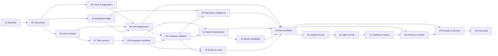

# Chayen Evolution — Master Plan

- **Program:** 20-step engineering improvement of the CodeJaDee Chayen
  Framework.
- **Baseline:** branch `develop`, HEAD `7427eb1`, package `chayen` `1.1.2`
  ([BASELINE_REPORT.md](BASELINE_REPORT.md)).
- **Rules:** [EXECUTION_RULES.md](EXECUTION_RULES.md).
- **Log:** [STEP_LOG.md](STEP_LOG.md). Read this plan and the latest log
  entry before every step.

This plan is a proposal for sequencing work. It approves no architecture
change. Steps that change an enforced limit, a registration rule, the
package or a provider interaction need the owner approvals named in their
blockers.

## Summary

| ID | Step | Prerequisites | Status | Known blockers |
|---|---|---|---|---|
| 01 | Baseline | — | PASS | — |
| 02 | Limit Policy and ADR | 01 | PASS | — (owner decision recorded: D-066, ADR-0013) |
| 03 | Skill Count and Registration | 02 (approved) | PASS | — |
| 04 | Line and Reference Depth Limits | 02 (approved) | PASS | — |
| 05 | Metadata Budget Policy | 02 (approved) | PASS | — |
| 06 | Limit Regression Tests | 03, 04, 05 | PASS | — |
| 07 | Task Contract Consistency | 01, 04 | PASS | — |
| 08 | Acceptance Evidence Contract | 07 | PASS | — |
| 09 | Guidance Consistency Validator | 06, 08 | PASS | — |
| 10 | Repository Intelligence | 05, 09 | PASS | — |
| 11 | Failure Reproduction | 08, 09 | PASS | — |
| 12 | Mentor Knowledge Distillation | 11 | NOT_STARTED | Scope to be confirmed by the owner at step start |
| 13 | Independent Evidence Audit | 08, 09 | NOT_STARTED | — |
| 14 | Evaluation Candidate Modernization | 06, 10, 11, 12, 13 | NOT_STARTED | — |
| 15 | Coding Evaluation Fixtures | 14 | NOT_STARTED | Stack toolchains (for example a .NET 8 SDK) must be available |
| 16 | Isolated Coding Agent Runner | 15 | NOT_STARTED | Live runs need owner authorization, a budget cap and isolated signed-in homes |
| 17 | Independent Grading and Metrics | 16 | NOT_STARTED | Human grading needs a named grader |
| 18 | Routing and Context Benchmark | 14, 17 | NOT_STARTED | Billed calls need authorization; Codex and Copilot homes need authentication (EG-02, EG-03) |
| 19 | Provider and Security Verification | 14, 18 | NOT_STARTED | Native install lifecycle and billed calls need explicit owner opt-in |
| 20 | Final Audit and Readiness | 01–19 | NOT_STARTED | — |

**Plan note (2026-10-22, Step 02):** the owner accepted D-066 /
[ADR-0013](../ADRS/ADR-0013-extensible-skill-governance.md). That decision
satisfies the "02 (approved)" prerequisite of Steps 03–05. Their scope is now
the removal of Class A caps and their replacement with measurement, as
listed per step in [MIGRATION_MATRIX.md](MIGRATION_MATRIX.md). Where a row
below says "implement the approved policy", the matrix gives the exact
targets. Per [rules §7](EXECUTION_RULES.md#7-after-a-step), those rows were
not edited in Step 02.

Every step uses this status vocabulary: `NOT_STARTED`, `IN_PROGRESS`,
`PASS`, `PARTIAL`, `BLOCKED`, `FAIL` ([rules §6](EXECUTION_RULES.md#6-step-status)).

## Dependency graph

Step 20 also depends on every earlier step. Those edges are omitted from the
graph.

## Steps

### 01 — Baseline

| Field | Value |
|---|---|
| Objective | Record a verified source baseline: repository state, manifests, every enforced limit and its dependants, and the current offline validation result. Create the program documents. |
| Prerequisite | None |
| Target files | `docs/chayen/evolution/` (new directory only) |
| Expected artifacts | `MASTER_PLAN.md`, `STEP_LOG.md`, `BASELINE_REPORT.md`, `EXECUTION_RULES.md` |
| Acceptance criteria | A1 baseline grounded in inspected source files; A2 existing worktree changes preserved; A3 offline validation status recorded; A4 all 20 steps have dependencies and expected outputs; A5 no product source file changed |
| Evidence | [STEP_LOG.md — Step 01](STEP_LOG.md#step-01--baseline) |
| Status | PASS |
| Blockers | None |

### 02 — Limit Policy and ADR

| Field | Value |
|---|---|
| Objective | Write one limit policy that states, for each limit in [BASELINE_REPORT §4](BASELINE_REPORT.md#4-enforced-limits): its purpose, source (provider document, internal budget or owner decision), hard or warning class, enforcement point and proposed value. Resolve the documented drift (ADR-0004 still says ≤15 and L0 6,500; the code enforces 16 and 7,000). Propose it as an ADR and decision for owner approval. |
| Prerequisite | 01 |
| Target files | New `docs/chayen/ADRS/ADR-0013-extensible-skill-governance.md`; `docs/chayen/ADRS/README.md`; `docs/chayen/DECISIONS.md` (D-066); amendment notices in `ADR-0004`, `SKILL_AUTHORING_STANDARD.md`, `SKILL_QUALITY_GATES.md`, `SKILL_REGISTRATION.md`; new `docs/chayen/evolution/MIGRATION_MATRIX.md` (replaces the planned `LIMIT_POLICY.md`; the policy table is ADR-0013 §1–§7) |
| Expected artifacts | Accepted ADR, decision record, four-class policy, migration matrix for Steps 03–06 |
| Acceptance criteria | Every limit in the baseline inventory appears in the policy with source, class, enforcement point and value; every drift item has a proposed resolution; the owner's decision is recorded verbatim (approve, amend or reject); no validator, constant or Skill file is changed in this step |
| Evidence | [STEP_LOG.md — Step 02](STEP_LOG.md#step-02--limit-policy-and-adr); D-066 in `DECISIONS.md` |
| Status | PASS |
| Blockers | None |

### 03 — Skill Count and Registration

| Field | Value |
|---|---|
| Objective | Implement the approved count and registration policy. Keep one source of truth for the Entry Skill ceiling and registration allow-lists, and keep registries closed-schema and developer-only. **As executed under D-066:** remove the count cap and the name allow-lists, and replace them with validated registration (ADR-0013 §7). |
| Prerequisite | 02 approved |
| Target files | `tools/catalog/skill-registration.mjs` (`MAX_ENTRY_SKILLS`, `PROJECT_NAMES`, `LANGUAGES`, editorial `length !== 2` check); `tools/catalog/check-catalog.mjs` (V-11.3); `tools/validate/validate-package.mjs` (V-07, V-19); `tests/catalog/*-mutations.json`; `docs/chayen/SKILL_REGISTRATION.md`; `tools/catalog/README.md`; `tools/validate/README.md` |
| Expected artifacts | Code change, boundary mutations at N and N+1, documentation aligned with the constant. **As executed:** code change, new `tests/catalog/registration.test.mjs` (G-13R), retargeted mutation cases, aligned documentation |
| Acceptance criteria | The ceiling is defined once and read by V-07, V-11.3 and registration; boundary mutations for N (pass) and N+1 (fail) exist and pass in `run-validator-tests.mjs`; `check-docs.mjs` and `tests/ci/documentation.test.mjs` pass; no Skill is added or removed; `validate-all.mjs` passes. **Superseded by D-066 and the owner's Step 03 criteria:** no failure caused only by exceeding 16 Skills; identity, structural, security and catalog-integrity checks still operate |
| Evidence | [STEP_LOG.md — Step 03](STEP_LOG.md#step-03--skill-count-and-registration) |
| Status | PASS |
| Blockers | None |

### 04 — Line and Reference Depth Limits

| Field | Value |
|---|---|
| Objective | Implement the approved `SKILL.md` and reference line limits (now 300 hard, 200 warning for `SKILL.md`, 300 hard for references) and link-depth rule (now 2 hops, skill-local) as shared constants. Align `ARCHITECTURE.md` and ADR-0004, which still describe a pack `INDEX.md` two-hop model that the skill-local layout (D-016) replaced. **As executed under D-066 and the owner's Step 04 instruction:** remove the line and depth caps as failures; report sizes with provider-derived advisory warnings; replace depth-limited recursion with an iterative, cycle-safe graph walk; allow transitive discovery while still failing orphans. |
| Prerequisite | 02 approved |
| Target files | `tools/validate/validate-package.mjs` (V-06, V-08); `tests/skills/validator-mutations.json`; `docs/chayen/SKILL_AUTHORING_STANDARD.md`; `docs/chayen/ARCHITECTURE.md` §8; `docs/chayen/ADRS/ADR-0004-*.md`; `tools/validate/README.md` |
| Expected artifacts | Constants, boundary mutations, aligned documents |
| Acceptance criteria | Limits defined once; boundary mutations for limit and limit+1 lines and for depth limit and depth+1; reference-line warning behaviour decided and tested; current Skills still pass (largest `SKILL.md` 230, largest reference 243 at baseline); `validate-all.mjs` passes. **Superseded by the owner's Step 04 criteria:** no former length or depth limit is a hard failure; reference integrity and safety failures stay blocking; existing Skills validate |
| Evidence | [STEP_LOG.md — Step 04](STEP_LOG.md#step-04--line-and-reference-depth-limits) |
| Status | PASS |
| Blockers | None |

### 05 — Metadata Budget Policy

| Field | Value |
|---|---|
| Objective | Implement the approved metadata policy: L0 budget (now 7,000 characters, 6,563 used), per-description target and hard limit (420 / 1,024), distinctness thresholds (0.25 warning / 0.35 error), breadth rules, and how actual and projected metadata are measured and reported. **As executed under D-066 and the owner's Step 05 instruction:** remove the 7,000-character failure without a replacement cap; report discovery metadata (characters, estimated tokens, per-skill contributions, expensive descriptions, collision risk) and documented provider figures, marked UNKNOWN or NOT_MEASURED where not reliable. |
| Prerequisite | 02 approved |
| Target files | `tools/catalog/skill-registration.mjs` (`L0_BUDGET`); `tools/validate/validate-package.mjs` (V-07, V-07b, V-20); `tools/evals/run-evaluation-suite.mjs` (context overhead); `tools/validate/check-docs.mjs` (D-06); `tests/ci/documentation.test.mjs`; `tests/catalog/editorial-mutations.json`; metadata statements in `README.md`, `docs/SKILLS_CATALOG.md`, `docs/AUTOMATIC_SKILL_DISCOVERY.md`, `docs/CONTRIBUTING.md`, `docs/chayen/KNOWN_LIMITATIONS.md` |
| Expected artifacts | Constants, measurement and report changes, aligned documents |
| Acceptance criteria | Each metadata threshold is defined once; boundary tests at budget and budget+1; the evaluation report and V-07 compute the same L0 value; no Skill description changes unless the decision requires it, and any change updates the metadata fingerprint record; `validate-all.mjs` passes **Superseded by the owner's Step 05 criteria:** every test and validator affected by the 7,000 limit updated; no historical test silently disabled; the metadata report available and accurate. |
| Evidence | [STEP_LOG.md — Step 05](STEP_LOG.md#step-05--metadata-budget-policy) |
| Status | PASS |
| Blockers | None |

### 06 — Limit Regression Tests

| Field | Value |
|---|---|
| Objective | Add one offline regression suite that proves every limit is enforced at its boundary and that limit values stated in maintained documents match the constants. |
| Prerequisite | 03, 04, 05 |
| Target files | New `tests/ci/limits.test.mjs` (or an extension of `tests/ci/documentation.test.mjs`); `tools/validate/validate-all.mjs` (register the suite); mutation JSON files **As executed:** new `tests/ci/limits.test.mjs` (G-13L); `tests/ci/negative-controls.test.mjs` registered (G-14N); `validate-package.mjs` V-18 scope; `phase5.test.mjs` count pin; documentation clarifications. |
| Expected artifacts | Test file, `validate-all.mjs` entry, documented coverage table Plus `docs/chayen/evolution/LIMIT_MIGRATION_REPORT.md` (owner's Step 06 deliverable). |
| Acceptance criteria | Every limit in the Step 02 policy has a passing case at the boundary and a failing case one past it; a stale limit in a maintained document fails the suite; historical sections (`<!-- historical:start -->`) are exempt; the suite runs offline in temporary copies only |
| Evidence | [STEP_LOG.md — Step 06](STEP_LOG.md#step-06--limit-regression-tests); [LIMIT_MIGRATION_REPORT.md](LIMIT_MIGRATION_REPORT.md) |
| Status | PASS |
| Blockers | None beyond prerequisites |

### 07 — Task Contract Consistency

| Field | Value |
|---|---|
| Objective | Make the task contract, its template, the change summary and the verification report use one vocabulary for acceptance criteria, verdicts (`accept`, `verify_more`, `revise`; D-064) and `DONE`, and make the five Skills that reference them consistent. **As executed under the owner's Step 07 instruction:** one decision policy (clarify an unclear request first; full contract and per-action approval for any risky action; proportional contract for several files or layers; nothing for a fully specified low-risk change; re-decide on scope growth), kept in full in the task-contract recipe and summarized in the entry skill. The evidence-contract work stays in Step 08. |
| Prerequisite | 01, 04 (Skill bodies may grow) |
| Target files | `skills/chayen-implementation/references/task-contract.md`, `task-contract-template.md`, `change-summary.md`, `verification-report-template.md`; Verification sections of `chayen-implementation`, `chayen-backend`, `chayen-frontend`, `chayen-data`, `chayen-testing` `SKILL.md` |
| Expected artifacts | Consistency table (term, definition, files), guidance edits, recipe cases for changed behaviour |
| Acceptance criteria | Each term has one definition and is used the same way in every listed file; every guidance change has a recipe or trigger case in `tests/skills/`; Skill descriptions unchanged; line limits hold; `validate-all.mjs` passes |
| Evidence | [STEP_LOG.md — Step 07](STEP_LOG.md#step-07--task-contract-consistency) |
| Status | PASS |
| Blockers | None beyond prerequisites |

### 08 — Acceptance Evidence Contract

| Field | Value |
|---|---|
| Objective | Define the record that links each acceptance criterion to planned evidence, observed evidence, evidence level (static, simulated, provider, human; D-046) and verdict, and how it maps to the evidence-audit verdicts. **As executed under the owner's Step 08 instruction:** the change-summary recipe defines the acceptance record (nine fields), the verdict rules with an evidence-adequacy table, and the DONE/PARTIAL/BLOCKED outcome; templates, five entry skills and twelve workflows use the same semantics. |
| Prerequisite | 07 |
| Target files | `skills/chayen-implementation/references/task-contract-template.md`, `change-summary.md`, `verification-report-template.md`; `docs/chayen/SKILL_AUTHORING_STANDARD.md` (if a shared section is needed) |
| Expected artifacts | Evidence contract specification, template changes, recipe cases |
| Acceptance criteria | The contract has a field for every element above; an observed-evidence field cannot be satisfied by a plan or a claim; `DONE` requires all criteria at `accept` with observed evidence; recipe cases cover a missing-evidence case; `validate-all.mjs` passes |
| Evidence | [STEP_LOG.md — Step 08](STEP_LOG.md#step-08--acceptance-evidence-contract) |
| Status | PASS |
| Blockers | None beyond prerequisites |

### 09 — Guidance Consistency Validator

| Field | Value |
|---|---|
| Objective | Add a developer-only static check that the shared vocabulary from Steps 07–08 (verdicts, statuses, evidence levels) is used consistently in shipped Skill content. |
| Prerequisite | 06, 08 |
| Target files | New `tools/validate/check-guidance.mjs` (or a V-number inside `validate-package.mjs`); `tools/validate/validate-all.mjs`; `tests/skills/validator-mutations.json`; `tools/validate/README.md`; `docs/chayen/SKILL_QUALITY_GATES.md` **As executed:** `tools/validate/check-guidance.mjs`, `tools/validate/guidance-invariants.json`, `tests/skills/guidance-consistency.test.mjs`, `docs/chayen/GUIDANCE_INVARIANTS.md`, gates G-18 and G-18T. |
| Expected artifacts | Validator, negative controls, gate documentation |
| Acceptance criteria | The validator runs offline with zero dependencies, outside the plugin; at least one negative control per rule fails as expected; the current package passes; `check-security.mjs` passes for the new file |
| Evidence | [STEP_LOG.md — Step 09](STEP_LOG.md#step-09--guidance-consistency-validator) |
| Status | PASS |
| Blockers | None beyond prerequisites |

### 10 — Repository Intelligence

| Field | Value |
|---|---|
| Objective | Improve how Skills discover a repository's stacks, commands, layout and conventions (including the `.chayen/` project map, D-065) before acting, without adding always-on content. **As executed under the owner's Step 10 instruction (D-067):** `.chayen/` unit files carry a lightweight, evidence-cited change-impact map with git fingerprints; readers start from the owning unit file, check staleness read-only, and confirm facts in the source. |
| Prerequisite | 05, 09 |
| Target files | `skills/chayen-repository/` (`repository-profile.md`, `stack-detection.md`, `dependency-and-impact.md`); `skills/chayen-init/references/detection-and-refresh.md`; Discover steps in the five consuming Skills |
| Expected artifacts | Guidance changes, recipe and trigger cases, fixture variants if needed |
| Acceptance criteria | Every changed rule has a case in `tests/skills/`; descriptions change only within the Step 05 budget, with the metadata fingerprint recorded; `validate-all.mjs` passes; behaviour claims stay `NOT_RUN` until Step 18 |
| Evidence | [STEP_LOG.md — Step 10](STEP_LOG.md#step-10--repository-intelligence) |
| Status | PASS |
| Blockers | None beyond prerequisites |

### 11 — Failure Reproduction

| Field | Value |
|---|---|
| Objective | Make reproduce-before-fix explicit and consistent: a failing test or recorded reproduction first, the fix second, the same check passing after. **As executed under the owner's Step 11 instruction (D-068):** a developer-only, opt-in failure-reproduction workflow: `chayen-failure-case/1` records in `tests/failures/`, validated and replayed offline by `tools/evals/failure-cases.mjs` (G-20, G-20T), with a verification status derived only from authorized live replays. The agent-facing reproduce-before-fix guidance in the target files below was not changed and remains open for an owner decision. |
| Prerequisite | 08, 09 |
| Target files | `skills/chayen-implementation/references/bug-fix.md`, `workflow-bug-repair.md`; `skills/chayen-testing/references/failing-and-flaky-tests.md`, `workflow-testing-regression.md` |
| Expected artifacts | Guidance changes linked to the Step 08 evidence contract; recipe and workflow cases |
| Acceptance criteria | The reproduction is recorded as observed evidence under the Step 08 contract; the no-reproduction path is defined (`verify_more`, not `accept`); cases cover both paths; `validate-all.mjs` passes |
| Evidence | [STEP_LOG.md — Step 11](STEP_LOG.md#step-11--failure-reproduction) |
| Status | PASS |
| Blockers | None beyond prerequisites |

### 12 — Mentor Knowledge Distillation

| Field | Value |
|---|---|
| Objective | Turn observed agent failures and reviewer feedback into tests and the smallest guidance fix, extending the failure-to-fix process in `docs/CONTRIBUTING.md` (D-065). The exact meaning of "mentor knowledge" is confirmed with the owner at step start. |
| Prerequisite | 11 |
| Target files | `docs/CONTRIBUTING.md`; `tests/skills/README.md`; a new intake template under `docs/chayen/evolution/`; affected Skill references |
| Expected artifacts | Intake template, worked example traced from failure to case to fix |
| Acceptance criteria | Owner-confirmed scope recorded; at least one real recorded failure (from existing results or Step 11) traced end to end; no unverified failure is presented as observed; `validate-all.mjs` passes |
| Evidence | STEP_LOG entry |
| Status | NOT_STARTED |
| Blockers | Owner scope confirmation |

### 13 — Independent Evidence Audit

| Field | Value |
|---|---|
| Objective | Strengthen the `task-evidence-audit` capability (CAP-18-003, recipe `skills/chayen-implementation/references/change-summary.md`) so the audit re-checks evidence independently of the implementer's claims. |
| Prerequisite | 08, 09 |
| Target files | `skills/chayen-implementation/references/change-summary.md`; `catalog/engineering-capabilities.yaml` (CAP-18-003 verification text only, no inventory change); `tests/skills/recipe-cases.json` |
| Expected artifacts | Audit procedure, cases for a claim without evidence and for evidence that contradicts the claim |
| Acceptance criteria | The audit verdict depends on re-observed evidence, not the implementer's summary; 206 inventory and fingerprint unchanged; `check-catalog.mjs` passes; `validate-all.mjs` passes |
| Evidence | STEP_LOG entry |
| Status | NOT_STARTED |
| Blockers | None beyond prerequisites |

### 14 — Evaluation Candidate Modernization

| Field | Value |
|---|---|
| Objective | Re-freeze the evaluation candidate on the current package. The Phase 5 candidate pins commit `38570b3` and metadata fingerprint `339b3125d1347648` (15 Skills). The current package is `411b6adbbea7e121` (16 Skills, 263 files), so live Phase 5 runs refuse at preflight. Keep historical results labelled as historical. |
| Prerequisite | 06, 10, 11, 12, 13 (guidance stable before freezing) |
| Target files | `tests/evaluation/phase5/` (new dated `results/<date>/candidate.json`, probe specs); `tests/provider-compatibility/qualify-rc.mjs` outputs; `tests/evaluation/phase5/phase5.test.mjs`; `docs/chayen/EVALUATION_GAPS.md` |
| Expected artifacts | New candidate record, updated probe sets covering all 16 Skills, plan output |
| Acceptance criteria | The candidate fingerprint equals the package fingerprint at a recorded commit; `--plan` runs offline with the new candidate; old results are not overwritten; offline Phase 5 tests pass |
| Evidence | STEP_LOG entry |
| Status | NOT_STARTED |
| Blockers | A frozen candidate needs a committed source state, and committing needs owner instruction (rules §4) |

### 15 — Coding Evaluation Fixtures

| Field | Value |
|---|---|
| Objective | Add buildable, per-stack fixtures with hidden acceptance tests for coding tasks (closes part of EG-06 and EG-14: today one non-buildable multi-stack fixture exists). |
| Prerequisite | 14 |
| Target files | New `tests/evaluation/coding/` fixtures and task specs; `tools/validate/check-security.mjs` scope if new file types are added |
| Expected artifacts | Fixtures, task specifications, hidden tests, fixture README |
| Acceptance criteria | Each fixture builds and its hidden tests fail before and pass with a reference solution, verified locally; no fixture is inside the plugin; secrets scan passes |
| Evidence | STEP_LOG entry with build and test output per stack |
| Status | NOT_STARTED |
| Blockers | Local toolchains per stack. Stacks without a toolchain stay `NOT_RUN`. |

### 16 — Isolated Coding Agent Runner

| Field | Value |
|---|---|
| Objective | Run coding tasks against disposable fixture copies with native permissions, isolated provider homes, and the authorization and budget guards already used by `run-phase5.mjs`. Plugin and no-plugin arms. |
| Prerequisite | 15 |
| Target files | New `tests/evaluation/coding/run-coding.mjs` and library; offline tests with fake providers; `tools/validate/validate-all.mjs` (offline tests only) |
| Expected artifacts | Runner, offline test suite, run-record schema |
| Acceptance criteria | Without authorization, budget cap and isolated home the runner sends nothing (tested); no permission-bypass flag; outputs go outside the repository; offline tests pass. A live run is a separate, authorized action. |
| Evidence | STEP_LOG entry |
| Status | NOT_STARTED |
| Blockers | Live use needs owner authorization, budget, and signed-in isolated homes |

### 17 — Independent Grading and Metrics

| Field | Value |
|---|---|
| Objective | Grade coding runs independently of the agent: hidden tests, a rubric, and human review where required. Define metrics (task success, routing precision and recall, reference loads, cost) with sample sizes. |
| Prerequisite | 16 |
| Target files | New grader under `tests/evaluation/coding/`; `docs/chayen/EVALUATION_REPORT.md` method section; rubric document |
| Expected artifacts | Grader, rubric, metric definitions, scorer self-test |
| Acceptance criteria | The grader never reads the agent's own success claim as evidence; scorer self-test with known-good and known-bad records passes offline; human-graded items are labelled and never pooled with automatic ones |
| Evidence | STEP_LOG entry |
| Status | NOT_STARTED |
| Blockers | A named human grader for human-scored items |

### 18 — Routing and Context Benchmark

| Field | Value |
|---|---|
| Objective | Measure routing across all 16 Skills (plugin and baseline arms, at least 3 runs) and context overhead with provider token counts instead of the characters/4 estimate (EG-12). |
| Prerequisite | 14, 17 |
| Target files | `tests/evaluation/phase5/routing-probes.json`; `tools/evals/run-evaluation-suite.mjs` (pooled reporting); results directory outside the repository, summarized into `docs/chayen/EVALUATION_REPORT.md` |
| Expected artifacts | Recorded runs, summaries, updated evaluation report |
| Acceptance criteria | Every number traces to a recorded run on the Step 14 candidate; no simulated proxy result is reported as provider evidence; runs with errors are reported, not dropped |
| Evidence | STEP_LOG entry, run summaries |
| Status | NOT_STARTED |
| Blockers | Billed calls need authorization; Codex and Copilot need authenticated isolated homes (EG-02, EG-03) |

### 19 — Provider and Security Verification

| Field | Value |
|---|---|
| Objective | Verify native install, update and uninstall of the current version on Claude Code, Codex and Copilot, and run the security and prompt-injection cases (EG-09) on the installed candidate. |
| Prerequisite | 14, 18 |
| Target files | `tests/provider-compatibility/` runbooks and results; `tests/evaluation/phase5/security-cases.json`; `docs/COMPATIBILITY_MATRIX.md`; `docs/production/NATIVE_LIFECYCLE_REPORT.md` |
| Expected artifacts | Lifecycle transcripts, security run summaries, updated compatibility matrix |
| Acceptance criteria | Each provider row cites a recorded transcript for the current version, or stays `NOT_RUN`; no critical security outcome is left unexplained; native permissions unchanged |
| Evidence | STEP_LOG entry, transcripts |
| Status | NOT_STARTED |
| Blockers | Explicit owner opt-in for install lifecycle and billed calls |

### 20 — Final Audit and Readiness

| Field | Value |
|---|---|
| Objective | Audit Steps 01–19 against their acceptance criteria, rerun all offline gates, and state readiness, separating verified results from `NOT_RUN` ones. No release. |
| Prerequisite | 01–19 |
| Target files | New `docs/chayen/evolution/FINAL_AUDIT.md`; this plan |
| Expected artifacts | Audit report, readiness verdict, open-risk list |
| Acceptance criteria | Every step has a status backed by its log entry; every invariant in [rules §3](EXECUTION_RULES.md#3-invariants-that-every-step-preserves) re-checked; `validate-all.mjs` and `run-evaluation-suite.mjs` pass; no release action taken |
| Evidence | STEP_LOG entry, audit report |
| Status | NOT_STARTED |
| Blockers | None beyond prerequisites |
